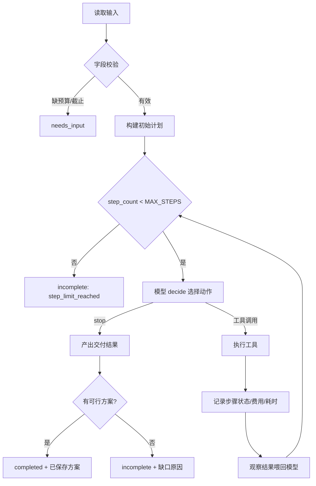

# 内容任务规划 Agent — 实现方案

## 1. 概述

### 用户与目标
帮助运营人员在**预算**与**截止时间**双重约束下，完成一份内容活动方案，并落地为可保存、可复现的任务计划。

### 输入与输出
| 方向 | 内容 |
|---|---|
| 输入 | 主题、预算、截止时间（可用工时）、素材/工具费用与耗时表 |
| 输出 | 任务计划、步骤状态、工具结果、费用合计、已保存方案（或未完成原因） |

### 范围与非目标
- **范围**：本地 CLI、合成素材/工具目录、ReAct 决策循环、状态管理、成本/耗时估算、方案保存。
- **非目标**：真实线上部署、多 Agent、生产级 Runtime、真实联网检索、界面。

---

## 2. 技术决策

| 项 | 决定 | 理由 |
|---|---|---|
| 引擎 | 原生 Python 手写 ReAct | 零第三方依赖、隔离环境易复现；循环与状态是核心，手写最能体现工程理解和主动设计 |
| 模型 | 双入口：真实 LLM + 离线 Mock | 有 key 时用真实模型证明 ReAct；无 key 时用 Mock 跑通流程并标注边界 |
| LLM 协议 | OpenAI 兼容 `chat/completions`，标准库 `urllib` 直连 | 保持零依赖，`base_url` 可配接任意兼容服务 |
| 运行方式 | CLI | 命令可复制，与示例一致 |
| 截止时间 | `deadline_hours`（可用工时） | 与耗时表同源，估算工具可直接对比 |

---

## 3. 目录结构

```text
.
├── README.md                     # 环境、安装、运行、评审导航
├── requirements.txt              # 标准库 only，无第三方依赖
├── .env.example                  # LLM_BASE_URL / LLM_API_KEY / LLM_MODEL
├── docs/01~05                    # 需求/方案/评估/AI使用/复盘
├── src/
│   ├── __init__.py
│   ├── main.py                   # CLI 入口
│   ├── agent.py                  # ReAct 引擎：循环 + 步数上限 + 状态推进
│   ├── state.py                  # State/Step 数据模型 + checkpoint 序列化
│   ├── planner.py                # 初始任务计划（预设骨架）
│   ├── models/
│   │   ├── __init__.py
│   │   ├── base.py               # Model 抽象 + Action/ToolSchema
│   │   ├── llm.py                # 真实 LLM 模型（urllib 直连）
│   │   └── offline_mock.py       # 离线确定性 Mock 决策（标注边界）
│   └── tools/
│       ├── __init__.py
│       ├── registry.py           # 工具注册 + 统一执行 + 失败注入
│       ├── search.py             # 素材检索
│       ├── script.py             # 脚本生成
│       ├── estimate.py           # 成本估算（费用 + 耗时）
│       └── save.py               # 方案保存（幂等）
├── data/catalog.json             # 素材/工具费用耗时表
├── tests/                        # 可执行测试
└── examples/                     # 输入、实际输出、Trace
```

---

## 4. 输入与数据 Schema

### 输入（`--input` JSON）
```jsonc
{
  "topic": "新品上线内容活动",
  "budget": 10,
  "deadline_hours": 20,
  "fail_injections": []              // 可选，测试注入失败
}
```

`fail_injections` 形如 `[{"tool": "generate_script", "on_call": 1}]`，表示该工具第 1 次调用返回失败、后续恢复正常，用于验证模型失败后调整动作。

### 素材/工具目录（`data/catalog.json`）
素材分档以制造「初始方案超预算 → 改选替代方案」的重规划场景。

```jsonc
{
  "materials": [
    {"id": "mat_premium",  "name": "高端定制素材", "cost": 9, "hours": 6},
    {"id": "mat_standard", "name": "标准素材",     "cost": 5, "hours": 4}
  ],
  "tools": [
    {"id": "tool_script", "name": "脚本生成", "cost": 1, "hours": 1},
    {"id": "tool_design", "name": "视觉设计", "cost": 2, "hours": 2}
  ]
}
```

- 方案 A = 高端素材(9) + 脚本(1) + 设计(2) = **12** → 超预算
- 方案 B = 标准素材(5) + 脚本(1) + 设计(2) = **8** → 符合预算

---

## 5. 状态模型

```python
Step = {
    "id": str, "name": str, "tool": str, "params": dict,
    "status": "pending" | "running" | "success" | "failed" | "skipped",
    "result": dict, "cost": float, "hours": float, "error": str | None
}

State = {
    "input": dict,               # topic / budget / deadline_hours
    "steps": [Step],             # 计划与执行状态
    "total_cost": float,
    "total_hours": float,
    "observations": [dict],      # 每轮工具返回摘要，喂给模型
    "status": "running" | "completed" | "needs_input" | "incomplete",
    "reason": str | None,
    "step_count": int
}
```

状态是「保留成功结果」和「失败续跑」的基础：失败步骤保留 `failed` 及错误信息，成功步骤保留 `success` 及结果，重规划只调整未完成部分。

`status` 中 `running` 仅表示运行中；最终交付态收敛为 `needs_input` / `completed` / `incomplete` 三种，`tool_error` 不再单列，统一用 `incomplete` + `reason` 表达。

---

## 6. 工具设计

统一返回 `{"ok": bool, "data": dict | None, "error": str | None, "retryable": bool | None}`，注册在 `registry`，统一支持 `fail_injections` 失败注入。`retryable` 仅在 `ok=false` 时有意义，失败注入默认 `retryable=true`。

| 工具 | 输入 | 输出 | 说明 |
|---|---|---|---|
| `search_material` | `topic` | 可用素材列表（含分档费用/耗时） | 检索阶段 |
| `generate_script` | `topic, material_ids` | 脚本内容 + 引用素材 | 可被注入失败 |
| `estimate_cost` | `material_ids, tool_ids, budget, deadline_hours` | 总费用、总耗时、是否超预算/超截止 | 决策关键观察 |
| `save_plan` | 方案对象 | `plan_id` + 保存结果 | 幂等 |

`estimate_cost` 返回中显式带 `over_budget` / `over_deadline` 标志，作为喂给模型的观察，而非直接终止条件。

---

## 7. ReAct 引擎

```python
MAX_STEPS = 12  # 可配置

while state.step_count < MAX_STEPS:
    observation = summarize(state)          # 步骤状态 + 已花费用/耗时 + 上一步结果
    action = model.decide(observation, tools_schema)
    if action.kind == "stop":
        break
    result = execute_tool(action)           # 成功/失败都记录
    state.record(action, result)            # 更新步骤状态、费用、耗时、observations
    state.step_count += 1

# 超步数或模型主动 STOP → 产出交付结果
deliverable = build_deliverable(state)
```



关键点：**预算/截止超限只写进观察，由模型决定换方案或停止**，引擎不硬编码停止；步数上限是唯一硬安全阀。

---

## 8. 模型双入口

### 抽象
```python
class Model(ABC):
    def decide(self, observation: dict, tools_schema: list) -> Action: ...

Action = {"kind": "tool" | "stop", "tool": str, "args": dict, "reason": str | None}
```

### 真实 LLM（`llm.py`）
- 标准库 `urllib` 直连 `POST {LLM_BASE_URL}/chat/completions`。
- Prompt 注入：角色规则（只用给定素材、不编造数字、预算/截止约束、失败须调整且失败步骤不得记为成功）+ 当前状态摘要 + 工具 schema。
- 模型输出 JSON 动作：`{"action":"estimate_cost","args":{...}}` 或 `{"action":"stop","reason":"...","summary":"..."}`。
- 解析失败 / 超步数 → 明确 `incomplete`。

### 离线 Mock（`offline_mock.py`）
- 走**同一个循环**，但决策为确定性策略：读观察标志而非写死数值，默认从高端素材起、超支/失败时按规则调整。
- 三条确定性序列：
  - A 预算超限：`search → generate(premium) → estimate(premium)=12 over → generate(standard) → estimate(standard)=8 → save → stop(completed)`
  - B 工具失败：`search → generate(premium) 失败(retryable) → generate(premium) 重试成功 → estimate(premium)=12 ok → save → stop(completed)`
  - C 无可行方案：`search → generate(premium) → estimate(premium)=12 over → generate(standard) → estimate(standard)=8 仍 over → stop(incomplete, reason="no_feasible_plan")`
- 失败处理：`ok=false` 且 `retryable=true` → 模型选择重试一次；仍失败或 `retryable=false` → `stop(incomplete)`。
- 明确边界：**只验证引擎循环与状态机制，不构成 ReAct 决策证据**；真实 ReAct 由 `LLMModel` 体现。

---

## 9. 动态决策（重规划）

| 触发 | 模型观察 | 模型动作 |
|---|---|---|
| 预算超限 | `estimate_cost` 返回 `over_budget: true`（如 12 > 10） | 改选低价素材（如标准素材 8）再估算 |
| 工具失败 | 某工具返回 `ok: false` | 重试 / 换工具 / 换参数；保留已成功步骤 |
| 部分成功 | 前面步骤 `success`、当前 `failed` | 基于已有成果调整后续，不丢弃成功结果 |
| 无可行方案 | 全部候选都超预算/超截止 | `stop`，返回 `incomplete` + 缺口 |
| 正常完成 | 估算在预算与截止内 | `save_plan` → `stop` |

约束：**失败步骤不得记为成功**；不能把未保存的方案记作已保存。

---

## 10. 幂等与续跑

- **幂等（重复执行）**：`save_plan` 以 `(topic + material_ids + tool_ids)` 的确定性哈希作 `plan_id`，同输入返回同一 id，不重复计费。
- **失败续跑（加分项）**：每步后把 `State` 序列化到 checkpoint 文件，`--resume` 时跳过 `success` 步骤，仅重跑 `failed` / `pending`。

---

## 11. 验收点 → 测试映射

| 验收点 | 测试场景 | 预期 |
|---|---|---|
| 正常完成 | budget=10 | 选标准方案(8) → `completed` + 已保存 |
| 缺预算/截止 | 缺 budget | `needs_input` |
| 工具失败 | 注入 generate_script 首次失败 | 模型调整/重试，**保留成功步骤** |
| 预算超限 | 高端=12 > 10 | 改标准=8 → `completed` |
| 重复执行 | 同输入跑两次 | plan_id 幂等一致 |
| 失败续跑（加分） | 中途失败 + `--resume` | 只重跑 failed/pending |

---

## 12. 运行命令与交付物

```sh
python -m src.main --input examples/normal.input.json
python -m src.main --input examples/missing.input.json
python -m src.main --input examples/tool-failure.input.json
python -m src.main --input examples/budget-overrun.input.json
python -m unittest discover -s tests -v
```

交付结果 `status` 为 `needs_input` / `completed` / `incomplete` 三值；`plan.steps` 承载步骤状态；`trace` 为对象数组（步骤、参数、返回摘要、后续动作、决策依据）；`saved_plan` 为 `{plan_id}` 对象，未保存时为 `null`；`incomplete` 时携带 `reason`。

```jsonc
{
  "status": "completed",
  "topic": "新品上线内容活动",
  "budget": 10, "deadline_hours": 20,
  "plan": {"steps": [{"id": "step_1", "tool": "search_material", "status": "success", "result": {}, "cost": 0, "hours": 0, "error": null}]},
  "tool_results": [{"tool": "estimate_cost", "args": {}, "ok": true, "summary": {"total_cost": 8, "over_budget": false}}],
  "total_cost": 8, "total_hours": 7,
  "saved_plan": {"plan_id": "a1b2c3"},
  "reason": null,
  "trace": [{"step": 1, "action": "estimate_cost", "args": {}, "result_summary": "...", "decision": "..."}]
}
```

---

## 13. 已知边界

- 真实 LLM 代码已实现但**未实跑**（当前无 API key）；示例 Trace 由离线 Mock 生成，文档如实标注「未验证真实模型决策效果」。
- 素材/工具为合成数据，脚本生成为模板占位，不评估真实创意与合规质量。
- 无持久化数据库与服务化，checkpoint 仅为本地文件，用于演示续跑机制。
